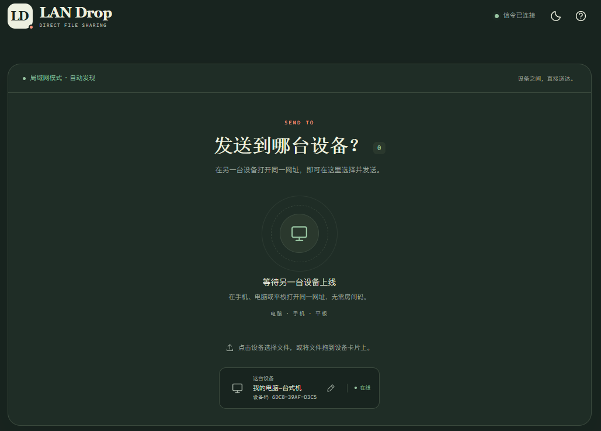

# LAN Drop

轻量、可自部署的浏览器文件分享工具。采用静态网页与小型 WebSocket 信令服务，通过 WebRTC DataChannel 在设备之间传输文件，无需账号、数据库或前端编译。

 

## 特性

- **设备发现**：支持公共大厅自动发现，以及房间码、邀请链接和二维码邀请。
- **文件直传**：点击设备或拖拽发送，多文件按顺序传输，文件内容不经过信令服务。
- **接收控制**：接收前确认，支持拒绝、取消、进度和速度显示。
- **两种保存方式**：普通接收后保存，或在支持的浏览器中直接写入所选文件夹。
- **跨设备界面**：适配桌面、手机和平板，支持主题切换、设备改名与设备码核对。
- **访问保护**：站点密码、来源 IP 限流、连接数限制和房间配额。

## 架构与发现模式

```text
设备 A ── WebSocket ── 信令服务 ── WebSocket ── 设备 B
                       设备发现 / 连接协商

设备 A ═══════ WebRTC DataChannel ═══════ 设备 B
                      文件传输
```

信令服务只负责访问验证、房间管理和连接协商，不接收或保存文件内容。WebRTC 数据通道使用 DTLS 加密；配置 TURN 时，加密流量可能经过 TURN 中继。

| 模式 | 设备可见范围 | 加入方式 | 适用场景 |
| --- | --- | --- | --- |
| `MODE=room`（默认） | 同一房间的设备 | 房间码、邀请链接或二维码 | 公网部署、临时分享 |
| `MODE=lan` | 所有通过站点访问验证并加入大厅的设备 | 打开同一站点后自动加入 | 已限制访问的可信网络 |

**`lan` 表示自动加入公共大厅，不代表只发现同一局域网设备。** 项目不扫描 Wi-Fi，也不按网段筛选访客。两种模式使用相同的传输协议；能看到设备不等于一定能建立文件连接。

默认 `ICE_SERVERS=[]`，不使用公共 STUN/TURN 服务，更适合同一局域网。跨网络传输取决于 NAT、防火墙和 ICE 配置。

## 快速开始

### Node.js

要求 **Node.js 22.9+**。在项目根目录执行：

```bash
npm ci --omit=dev --ignore-scripts
cp .env.example .env
```

编辑 `.env`，选择模式并设置访问密码：

```dotenv
HOST=0.0.0.0
PORT=3000
MODE=room
ACCESS_PASSWORD='替换为强密码'
```

启动服务：

```bash
npm start
```

默认地址为 `http://服务器IP:3000`。设备需访问相同的站点地址；正式部署应使用设备信任的 HTTPS 证书。

`npm start` 自动读取项目根目录的 `.env`。进程管理器需使用该目录作为工作目录。更新时保留现有 `.env`，安装依赖并重启服务，无需编译前端。

### Docker Compose

创建并编辑 `.env` 后，在服务器执行：

```bash
docker compose up -d --build
```

默认映射 `3000:3000`。使用反向代理时，建议改为 `127.0.0.1:3000:3000`。更新代码后重新执行上述命令；仅修改环境变量时执行 `docker compose up -d` 更新容器。

### HTTPS 与反向代理

参见 [`deploy/nginx.conf`](deploy/nginx.conf)，替换域名、证书路径和上游端口。

- 保留请求 Host，并允许 `/ws` 的 WebSocket Upgrade。
- Node 与代理在同一主机时，可设置 `HOST=127.0.0.1`。
- 当前仅支持域名根路径部署，不支持 `/lan-drop/` 等子路径。
- 默认 Node 服务同时提供前端与信令，建议统一代理整个站点。

来源 IP 限流默认使用直接连接地址，不信任转发请求头。同机 Nginx 部署可配置：

```dotenv
TRUSTED_PROXIES=127.0.0.1,::1
```

示例 Nginx 配置使用 `proxy_set_header X-Real-IP $remote_addr;` 覆盖访客传入的请求头。`TRUSTED_PROXIES` 只接受可信直接代理的具体 IP；容器环境应填写实际代理地址。使用 CDN 时，需先在代理层正确配置可信 CDN 的真实 IP 解析，否则访客可能共用限流额度。

如需独立托管 `public/`，还需同源代理 `/ws`、`/config.js`，并将 `node_modules/qrcode-generator/qrcode.js` 提供为 `/vendor/qrcode.js`；`/config.js` 不应缓存。

## 使用

1. 双方打开同一站点并完成访问验证。
2. 房间模式下，一方创建房间，另一方扫码、打开邀请链接或输入 8 位房间码加入；LAN 模式自动加入大厅。
3. 将目标设备卡片的设备码与对方页面的设备码核对，点击设备选择文件，或拖拽文件到卡片。
4. 接收方确认接收，等待传输完成后保存文件。

LAN 模式不显示房间码或房间操作。设置 `MODE=lan` 后默认必须配置访问密码；只有通过防火墙或反向代理认证限制访问的可信环境，才应显式设置 `ALLOW_PASSWORDLESS_LAN=true`。

### 文件保存

| 接收方式 | 行为 | 容量限制 |
| --- | --- | --- |
| 普通接收 | 先接收到浏览器内存，完成后点击保存到设备 | 当前页面保留的已接收文件与本次文件合计不超过 **256 MiB**（约 268 MB） |
| 保存到文件夹 | 先授权文件夹，边接收边写入磁盘 | 不受普通接收容量预算限制，仍受磁盘空间和权限约束 |

文件夹保存依赖 `showDirectoryPicker`，通常用于 HTTPS 下的桌面 Chrome/Edge。iOS Safari 使用普通接收；“保存”是将已收到的数据交给系统，并非从服务器再次下载。

普通接收的文件在刷新页面或清空记录后无法恢复。请先保存，再清空已结束记录以释放容量；仅点击保存不会自动释放。文件夹保存会优先为同名文件生成新名称，避免覆盖已有文件。

## 配置

配置模板见 [`.env.example`](.env.example)。修改实际 `.env` 或进程环境变量后需重启服务。

| 变量 | 默认值 | 说明 |
| --- | --- | --- |
| `HOST` | `0.0.0.0` | Node 监听地址 |
| `PORT` | `3000` | Node 监听端口；容器内部固定为 3000 |
| `MODE` | `room` | `room` 房间邀请，`lan` 公共大厅自动发现 |
| `ACCESS_PASSWORD` | 空 | 站点访问密码，最多 256 个字符；LAN 模式默认必需 |
| `ALLOW_PASSWORDLESS_LAN` | `false` | 显式允许无站点密码的 LAN 模式，不提供网络隔离 |
| `ALLOWED_ORIGINS` | 空 | 允许的 WebSocket 网页来源，逗号分隔；默认要求与请求 Host 同源 |
| `ICE_SERVERS` | `[]` | WebRTC ICE 服务的 JSON 数组 |
| `TRUSTED_PROXIES` | 空 | 可信直接代理 IP，逗号分隔；仅这些代理的 `X-Real-IP` 用于来源识别 |
| `MAX_CLIENTS` | `256` | 最大信令连接数，包含未验证连接 |
| `MAX_CONNECTIONS_PER_IP` | `16` | 每个来源 IP 的最大同时连接数 |
| `MAX_ROOM_PEERS` | `32` | 每个房间或 LAN 大厅的最大设备数 |
| `ROOM_IDLE_MINUTES` | `30` | 空房间保留时间，单位为分钟 |

需要跨网络连接时，可配置自有 STUN/TURN 服务，例如：

```dotenv
ICE_SERVERS='[{"urls":"stun:stun.example.com:3478"},{"urls":"turn:turn.example.com:3478","username":"专用用户名","credential":"专用密码"}]'
```

STUN 不保证穿透成功，复杂网络可能需要 TURN。ICE 配置会发给通过访问验证的浏览器，TURN 凭据应使用受限账号并配置配额。

## 安全与限制

- 公网部署推荐房间模式、强密码和 HTTPS，服务进程以非 root 用户运行。访问密码保护信令与设备发现，不限制静态页面；需要保护整个站点时应在代理层认证。
- 房间码、昵称和设备码不等于身份认证。设备码用于人工核对连接，重连后可能改变；文件接收需确认，项目不提供病毒扫描。
- 来源限流跨连接生效：每分钟最多 30 次连接尝试，密码失败窗口为 10 分钟、最多 5 次；每 10 分钟最多创建 5 个房间，同时最多保留 8 个未过期房间。同一 NAT 下的访客可能共享额度。
- 一次最多发送 **100 个文件**，每个页面同时只处理一组收发。双方应保持网页在前台，避免锁屏；手机实际可承受的文件大小可能低于接收预算。
- 不支持目录递归、断点续传、后台常驻或离线使用。发送文件夹时请先压缩；信令重连不会恢复未完成的传输。
- 房间与限流状态保存在单实例内存中，重启后重置；不支持多实例共享。服务重启后，房间模式需重新创建或加入房间。
- 网络隔离、防火墙或 NAT 可能阻止直连，项目不会自动退回服务器上传。应用限流不替代防火墙或 DDoS 防护。

## 项目结构

```text
.
├── public/                  静态前端
│   ├── index.html           页面与交互弹窗
│   ├── styles.css           样式与主题
│   ├── app.js               设备发现、房间邀请与界面交互
│   ├── transfer.js          WebRTC 连接与文件收发
│   ├── protocol.js          协议校验与文件名处理
│   ├── history.js           传输记录与下载链接管理
│   ├── dialogs.js           弹窗兼容与焦点管理
│   ├── boot.js              页面启动辅助
│   └── favicon.svg          网站图标
├── server/                  HTTP / WebSocket 信令服务
│   ├── index.js             服务入口与静态资源
│   ├── rooms.js             房间、访问验证与信令转发
│   ├── limits.js            来源识别与限流
│   └── security.js          页面安全策略
├── tests/                   Node.js 自动测试
├── scripts/browser-smoke.mjs 浏览器收发与界面测试
├── deploy/nginx.conf        HTTPS 反向代理示例
├── .env.example             配置模板
├── compose.yaml             Docker Compose 配置
├── Dockerfile               容器镜像定义
├── package.json             命令与依赖
└── package-lock.json        依赖锁文件
```

## 开发与测试

安装依赖后，在测试环境执行：

```bash
npm test
```

测试覆盖访问控制、房间隔离、信令服务、文件协议、传输记录、容量管理与文件保存。可选浏览器测试需已有 Edge、Chrome 或 Chromium：

```bash
node scripts/browser-smoke.mjs
node scripts/browser-smoke.mjs --lan --no-password
```

可通过 `BROWSER_PATH` 指定浏览器路径。测试不下载浏览器或编译前端，截图写入 `.artifacts/`；真实设备与网络仍需单独验收。

提交代码时不要包含 `.env`、`node_modules/` 或 `.artifacts/`。反馈问题请提供版本、浏览器、部署方式及复现步骤，并移除密码、TURN 凭据等敏感信息。
